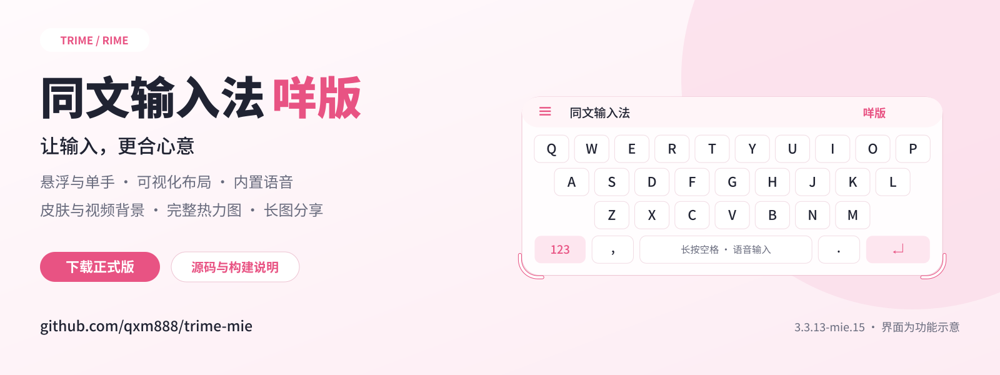
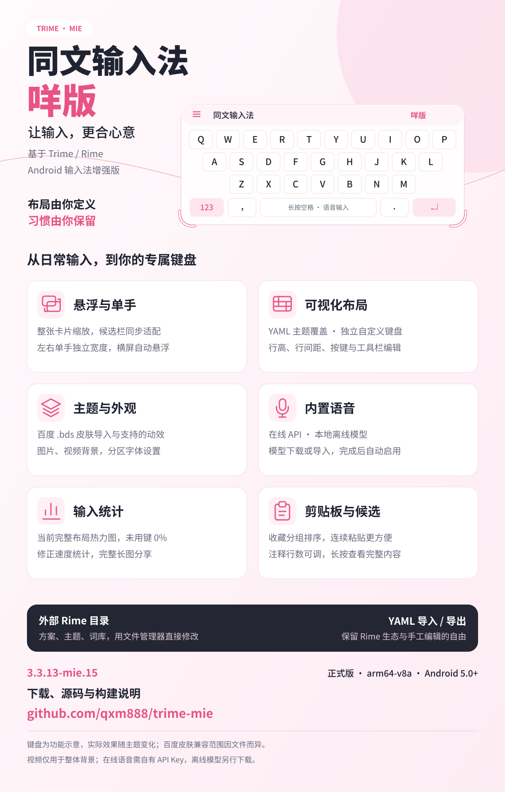
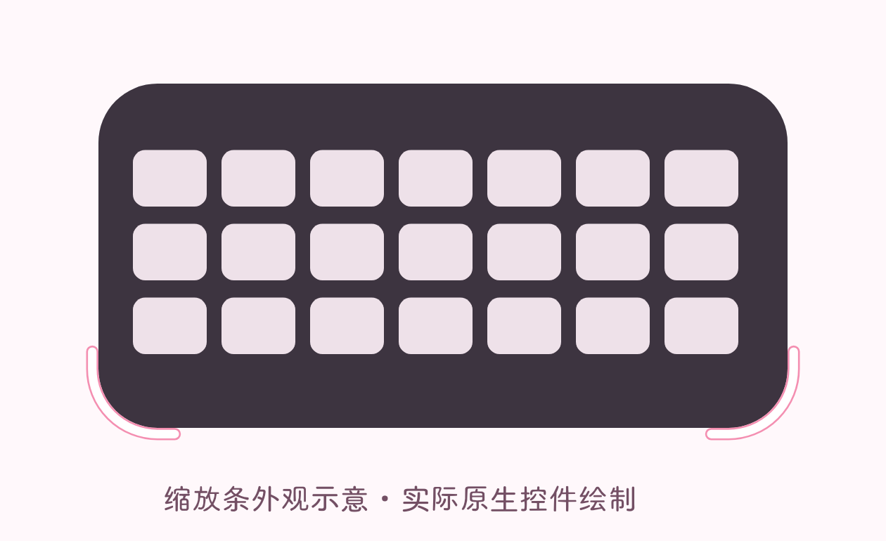

# 同文输入法咩版

基于 [同文 Trime](https://github.com/osfans/trime) 与 Rime 的 Android 输入法增强版。在保留方案、词库和 YAML 主题生态的基础上，加入悬浮键盘、完整单手模式、可视化布局、百度皮肤导入、输入统计与内置语音。

[**下载正式版 APK**](https://github.com/qxm888/trime-mie/releases/latest) · [更新记录](CHANGELOG.md) · [使用指南](docs/使用指南.md) · [源码与构建](BUILD.md) · [反馈问题](https://github.com/qxm888/trime-mie/issues)

> 当前源码版本：**V3.0.6**，正式 APK 文件名 `trime-mie-v3.0.6.apk`。本版已在 [Releases](https://github.com/qxm888/trime-mie/releases/latest) 发布。预编译 Rime 库的完整来源记录仍待补齐，详见 [原生依赖说明](NATIVE_BUILD.md)。

## V3.0.6 开机初始化修复

- 修复解锁前初始化时丢失设备保护上下文的问题；锁定阶段使用独立的应用内Rime目录和资源校验。
- 后台同步等待解锁后再启动，避免在直接启动模式初始化WorkManager；调度失败不终止键盘。
- 崩溃堆栈同步保存到设备保护目录，解锁后的普通日志导出也能查看，保留最近两次。

详见 [V3.0.6 定位与验证边界](docs/v3.0.6/更新说明.md)。隔离检查不代替真实关机开机验证。

## V3.0.5 主题键盘导入

- 布局管理新增“从主题键盘导入”，默认当前主题和布局，可生成新的独立自定义键盘。
- 转换行、按键、绑定、符号注解、外观和工具栏；自动生成跳转所需的数字／符号页。
- 冻结主题动作与宏，复制图片、视频和字体；生成后可继续编辑，支持原有整包备份与YAML元数据保存。
- 修正自定义键盘零横向键距被默认值覆盖的问题。

路径与兼容边界见 [V3.0.5 更新说明](docs/v3.0.5/更新说明.md)。

## V3.0.4 优化

- 修复手动接收失败丢失待上传内容、旧请求更新新连接状态；同步页面增加进度和重复提交保护。
- 静态模糊取消空轮询，已发布画面与工作位图分离；减少按键常态/按下态切换的重复圆角与边框更新。
- 大字体创建不再占用共享缓存锁；造词列表减少重复排序，取消离开页面后的旧加载任务。
- 修正悬浮候选翻页按钮尺寸恢复、字体导入目标，并改善小屏幕和横屏的预览空间。

详见 [V3.0.4 更新说明](docs/v3.0.4/更新说明.md)和[检查记录](docs/v3.0.4/检查记录.md)。

## V3.0.3 更新

- 自定义键盘新增悬浮候选窗编辑：实时预览，窗口、候选、文字、辅助分组，各布局独立保存。
- 修复美化残影和动画刷新、悬浮球透明区域拦截 Q、按键移动后保存覆盖相邻键；支持长按拖动插入。
- 悬浮球独立开关；悬浮键盘临时恢复候选/状态栏，回到普通键盘恢复隐藏偏好。
- 输入与候选新增造词管理，历史造词列表支持搜索、筛选及编辑词条、编码、所属方案。
- Android 17 局域网同步补齐运行时授权；保存相同配置也立即重试并保留待上传内容。

详见 [V3.0.3 更新说明与验证边界](docs/v3.0.3/更新说明.md)。

## V3.0.2 性能优化

- 按键背景圆角、边框和渐变只在参数变化时更新，减少连续输入的无效刷新与临时对象。
- 候选内容、布局和高亮没有变化时复用视图；字体、背景和尺寸有变化时仍重新计算。
- 静态背景模糊按需更新，视频帧合并刷新；关闭阴影和按压特效时跳过相应绘制与空动画。
- 减少普通按键的重复状态查询、字体列表分配及语音空闲状态发布。

详见 [V3.0.2 更新说明与验证边界](docs/v3.0.2/更新说明.md)。

## V3.0.1 更新

- 工具栏阴影统一在按钮下层绘制，修正圆角、按压波纹和文字阴影缩放。
- 修复绑定动作列表的读写转换，去掉自定义绑定选择器的主题加载依赖；绑定后仍保留空标签。
- 自定义键盘每行及状态栏独立设置靠左、居中、靠右、分散，预览、备份与 YAML 导出同步。
- 首页改为“搜索”搜索框入口，修正顶部工具栏约束与安全留白。
- 语音入口直达识别服务与模型，新增腾讯流式及极速文件接口。
- 语音状态栏使用真实音量驱动的细波形和轻柔话筒光晕，并区分连接、识别、模型加载状态。

详见 [V3.0.1 更新说明](docs/v3.0.1/更新说明.md)。

## V3.0 更新

- 原同文标记搭配淡粉色底，提供 Android 自适应、单色主题与旧系统图标。
- 每个设置页面顶部均保留“测试输入”按钮，点击才展开试打面板，关闭后不占页面空间。
- 忘词使用原生 `Control+Delete`；主题键盘新增分区域字体与字号，保持自定义键盘配置独立。
- 修复大字体超出缓存上限反复创建的问题，字体文件检查与加载移出重复绘制路径。
- 接通火山流式和 X-ASR 的部分结果，录音时逐步显示文字，最终结果替换临时内容。
- 集成 SyncClipboard / WebDAV 同步客户端，支持文本、图片和单文件；自动同步默认关闭。
- 本地语音模型放到 `rime/mie/语音模型/`，已有模型经校验后迁移，保留旧副本。
- 整包设置备份到 `rime/mie/备份/`，包含键盘、字体、背景、Rime 配置、统计与候选记录，支持跨目录一键恢复和可选模型备份。

详见 [V3.0 更新说明](docs/v3.0/更新说明.md)、[检查记录](docs/v3.0/检查记录.md)和[交接说明](docs/v3.0/交接说明.md)。

## V2.1.4 更新

- 外观编辑改为按键、工具栏、整体三页，带实时预览、折叠参数和柔光 / 通透 / 磨砂预设。
- 最左侧菜单按钮可编辑，工具栏及单个按钮支持背景、边框、圆角、模糊和材质特效；共用背景可叠加原工具栏背景。
- 每个自定义键盘分别保存外观、字体与字号；按键支持独立的符号和注解字号。
- 增加命名多动作功能，绑定选择器包含键盘跳转、系统 / Rime 按键和同文命令；移除关联键盘的自动跳转。
- 悬浮候选可选上方小箭头或底部左右翻页；长按候选新增两步造词，保留原候选。

详见 [V2.1.4 操作路径与说明](docs/v2.1.4/更新说明.md)。

## V2.1.3 更新

- 新增“按键特效”抽屉：外阴影、内阴影、渐变、渐变边框、顶部高光、磨砂颗粒、3D 键帽底边。
- 新增按压反馈：缩放、下沉、变暗、动画时长、从触点扩散的波纹。
- 新增文字/符号阴影，以及“一键美化 / 清空特效”预设。
- 所有模糊特效使用离屏缓存位图，输入时只绘制缓存；旧版外观 JSON 可无损升级。
- 包含 V2.1.2 的全部改动。

详见 [V2.1.3 更新说明与操作路径](docs/V2.1.3更新说明.md)。

## V2.1.2 更新

- 悬浮窗翻页改回右上方集中小箭头，撤掉底部翻页条。
- 主题与自定义键盘分别设置整体四角圆角，背景共用开关移入各自外观抽屉。
- 初始 Rime 目录自动补齐四份公共基础配置，不覆盖用户已有 YAML。
- 状态栏图片图标可调大小，并自动按比例适应按钮区域。
- 新增统计与候选调整备份页，支持跨设备导入、Rime 目录保存和分方案词典草稿导出。
- 长按候选增加“忘记”，后移保留、再次选中后提升；减少连续输入的重复计算与候选处理开销，增加慢输入日志。
- 包含 V2.1.1 的状态栏自定义按钮、独立外观和当前布局全体按键背景功能。

详见 [更新说明与操作路径](docs/V2.1.2更新说明.md)。继续使用传统 `rime` 目录与原正式版引擎。

## 功能一览

[下载功能海报](https://github.com/qxm888/trime-mie/releases/download/v3.3.13-mie.15/mie15-feature-poster.png) · [可编辑 SVG](docs/images/mie15-feature-poster.svg) · [源码构建说明](BUILD.md)

*海报使用原创矢量排版和合成键盘示意，不是设备截图；实际外观由所用主题决定。*

## 相比原版同文，增加了什么？

| 功能 | 咩版的扩展 |
| --- | --- |
| 悬浮键盘 | 整个键盘与候选/工具栏一起缩放；工具栏可收起；收起时拖动空白状态栏移动；两下角白底粉边短角条调整尺寸，并贴合圆角外沿 |
| 单手模式 | 整张键盘卡片靠左或靠右沉底，候选栏同步变窄；可选左边、右边、两边；宽度可在 40%–100% 调节 |
| 横屏适配 | 普通直板手机横屏可自动切换悬浮键盘；宽屏、展开折叠屏按横屏键盘策略适配 |
| 可视化布局 | 主题覆盖编辑与独立自定义键盘两套模式互斥、数据独立；调整按键绑定、行高、行间距和工具栏 |
| 外观定制 | 两种键盘模式的全局样式独立；整套按键与状态栏按钮可设置背景、边框、圆角和模糊；按键可加外/内阴影、渐变、渐变边框、高光、磨砂颗粒、3D 底边、按压缩放/下沉/波纹和文字阴影；当前布局可一键设置全体按键背景 |
| 状态栏编辑 | 按钮可增删、排序、启停；每个按钮支持显示内容、背景边框及点击/长按/双击/四向滑动绑定 |
| 字体设置 | 分别设置键盘、候选栏等区域字体 |
| 百度皮肤 | 导入 `.bds` 并适配布局、图片、按键音效与支持的动画；修复导入后键盘高度压缩问题 |
| 候选与注释 | 默认限制两行，可自定义行数或关闭限制；单行自动缩小可开关；长按查看完整内容；优化横屏边界和滚动 |
| 剪贴板与收藏 | 搜索、删除、临时保持面板展开集中在右侧菜单；收藏分类可编辑、排序；完善搜索与返回行为 |
| 输入统计 | 按方案统计，修正均速计算；热力图显示当前完整键盘，未使用键为 0%；支持分享完整长图 |
| 内置语音 | 无需切换外部输入法；支持在线 API 与本地离线模型，模型可下载或导入，下载完成自动安装、选择并启用 |
| 外部 Rime 目录 | 可直接使用 `/storage/emulated/0/rime`，用文件管理器修改方案、主题和词库后部署 |
| 设置界面 | 六类首页与实时搜索，设置按功能集中归属；采用 Material 3 分组样式 |

### 两套键盘编辑模式

- **YAML 主题模式**：沿用已有主题，在编辑器里覆盖按键绑定和工具栏设置，不直接改写原主题文件。
- **独立自定义模式**：单独管理布局、按键与背景；可选择指定键盘导出为可手工修改的 YAML。图片、视频等外部资源需另行复制。

两种模式同一时间只启用一种，保存的数据彼此独立。

### 悬浮与单手

悬浮键盘适合自由摆放和横屏输入，单手模式适合固定靠边输入。两者的宽度设置独立保存。单手模式正常展开工具栏，没有缩放条和拖动功能；通过单手模式按钮切换位置。

*上图为原生控件绘制的外观示意，使用合成键盘；实际外观随主题而变化。*

### 内置语音

默认长按空格开始，松开结束并将识别文字上屏；主题已有的明确长按绑定优先。需授予麦克风权限并在设置中选择引擎。

- **在线识别**：提供 OpenAI、SiliconFlow 等服务配置入口。由用户填写自己的 API Key；没有内置共享密钥或免配置免费服务。价格和可用模型以服务商为准。
- **离线识别**：支持 SenseVoice、Qwen3-ASR、FunASR Nano、Parakeet、FireRedASR V2、X-ASR 等模型系列；可测速选择下载源，也可导入模型包。
- 下载后自动完成解压、文件校验、安装与启用。模型单独下载，**不包含在 APK 中**；部分模型需要较多存储和内存。
- 离线引擎在设备上处理音频；在线引擎将音频发送至用户选择的服务商。

## 下载与安装

1. 可在 [Releases](https://github.com/qxm888/trime-mie/releases/latest) 下载 `trime-mie-v3.0.6.apk`。
2. 允许浏览器或文件管理器安装该 APK，安装后在系统设置启用“同文输入法咩版”并选为当前输入法。
3. 配置 Rime 方案与词库并部署。需要沿用旧目录时，按[使用指南](docs/使用指南.md)切换外部目录。

| 项目 | 当前安装包 |
| --- | --- |
| 应用名 | 同文输入法咩版 |
| 包名 | `com.osfans.trime.mie`，可与原版同文共存 |
| 版本 | `V3.0.2` / `20261130` |
| 系统 | Android 5.0 及以上 |
| 架构 | **arm64-v8a**；本次未提供 32 位或 x86 包 |
| 类型 | 签名正式版，无调试测试组件 |

升级前建议备份自己的方案、词库和布局。相同包名与签名可覆盖升级；与原版同文的数据按应用独立保存，外部目录可由用户显式选择。正式版与咩2也是独立应用。

Release 同时提供 `SHA256SUMS.txt`，可用于核对安装包完整性。

## 适配说明

- 百度皮肤包含专有格式与效果，不能保证每份皮肤及其全部动效完全还原；部分功能键需要重新绑定。
- 本地视频背景静音循环，键盘隐藏时暂停。播放格式支持和耗电情况取决于设备，建议使用较小的素材。
- 检查范围与限制见[本版检查记录](docs/v3.0/检查记录.md)。词典草稿需核对输入编码，卡顿改善和语音效果取决于设备与方案。
- 反馈时请提供版本、Android 版本、机型及复现步骤；请勿公开 API Key 或含私人内容的配置。

## 获取源码与构建

- [查看应用源码](app/src/main/) · [构建说明](BUILD.md) · [版本源码 ZIP（Release 附件）](https://github.com/qxm888/trime-mie/releases/latest)
- 默认 Debug 构建使用独立包名，适合自己修改与安装。Release 需配置自己的签名；发布私钥不在源码中。
- 原生预编译库的来源记录尚有缺口，详见 [NATIVE_BUILD.md](NATIVE_BUILD.md)，不将此次源码上传宣称为已完成全部二进制依赖来源核验。

## 致谢与许可证

- [Trime / 同文输入法](https://github.com/osfans/trime) 与 [Rime](https://github.com/rime)：基础输入法与引擎。
- [CatTrime](https://github.com/lzlv312/CatTrime)：悬浮、单手及相关交互参考与移植，遵循其 GPL 许可证。
- [BiBi Keyboard / 说点啥](https://github.com/BryceWG/BiBi-Keyboard)：内置语音的部分设置、协议与模型管理适配，Apache-2.0。
- [sherpa-onnx](https://github.com/k2-fsa/sherpa-onnx)：离线语音运行时，Apache-2.0。

咩版基于 Trime 衍生，沿用原项目 GPL-3.0-or-later 许可要求。相关第三方许可与声明保留在安装包内；本仓库附有 [GPL 许可证文本](LICENSE) 和[第三方声明](docs/第三方声明.md)。主题、皮肤、字体与模型各自的权利归原作者所有，本仓库不分发用户皮肤或模型素材。
