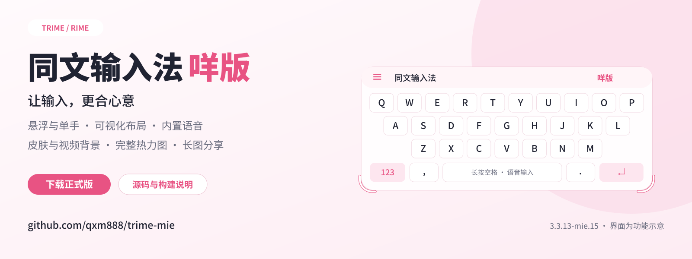
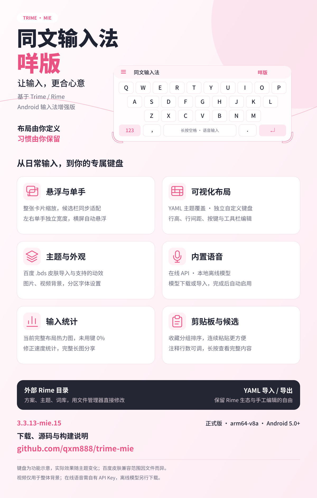
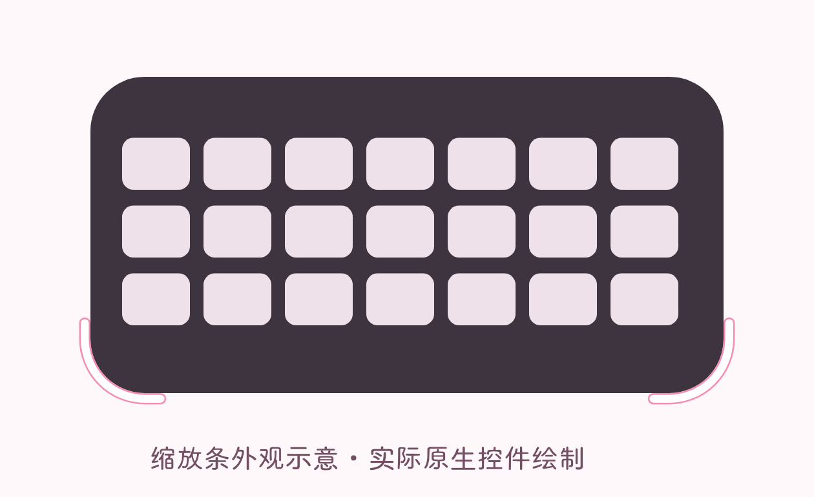

# 同文输入法咩版

基于 [同文 Trime](https://github.com/osfans/trime) 与 Rime 的 Android 输入法增强版。在保留方案、词库和 YAML 主题生态的基础上，加入悬浮键盘、完整单手模式、可视化布局、百度皮肤导入、输入统计与内置语音。

[**下载正式版 APK**](https://github.com/qxm888/trime-mie/releases/latest) · [更新记录](CHANGELOG.md) · [使用指南](docs/使用指南.md) · [源码与构建](BUILD.md) · [反馈问题](https://github.com/qxm888/trime-mie/issues)

> 当前版本：**V3.7.0 / versionCode 20271114**，正式安装包 `trime-mie-v3.7.0.apk`。原生依赖来源边界见 [NATIVE_BUILD.md](NATIVE_BUILD.md)。

## V3.7.0 常用句联想与输入修复

- 新增本地常用句学习：同一句滚动7天内完成输入3次后加入，输入句首可点击补全。默认关闭，入口为“设置 → 便捷功能 → 学习与联想常用句”。
- 联想提示改为紧凑单行，约40dp高，宽度随内容变化，自动避让原候选悬浮窗；支持关闭、长按删除和设置内管理。
- 修复自动顶字上屏时的码长归属；单手模式的编码区作为浮层显示，避免顶起应用输入框。
- 58项针对性本地回归、独立测试包真机功能与容量性能检查通过。原签名正式包可覆盖安装。

[更新说明](docs/v3.7.0/更新说明.md) · [验证范围](docs/v3.7.0/验证记录.md)。

## V3.3.2 键灵蹦跳踩键与 UR 伙伴

- 58 位键灵统一改为站姿蹦跳、左右脚交替踩迷你键盘，手部做挥手和平衡动作；小咩新增站立四表情，猴哥优化完整形象。
- 收紧迷你键盘底部留白，同键连按重新起跳，快速输入自适应缩短动作；拖动、缩放和回位继续可用。
- 新增 UR 小咩、猴哥及独立兑换记录；小咩专属兑换，其余 UR 入池，总基础概率 0.5%，增加 200 次 UR 保底。
- 横屏键盘增加透明度；符号面板改为四列导航；输入统计增加合并字词云；键盘 YAML 改为分区、每键一行的易读格式。
- 6 项本地测试及 .33 手机咩2专项通过，58 位角色各检查 3 个落脚点。正式 APK 已完成构建和原签名核对。

[更新说明](docs/v3.3.2/更新说明.md) · [验证范围](docs/v3.3.2/验证记录.md)。

## V3.3.0 典藏伙伴与商店兑换口

- 合入 GLM 设计的 20 位典藏伙伴（10 珍奇SR + 10 星耀SSR），图鉴与孵化池扩为 56 位；夜阑、烛龙、冰璃、雷霄、幽萤、玄武、白泽、沧溟、曜金、梦泽等全部原创设计。
- 典藏伙伴采用精修画风：渐变体积、白色边缘光、发光纹饰与瞳孔、金饰与光斑粒子，每位的虹膜配色专属。
- 20 位新伙伴按统一分层/代码脸规范接入：打字随机表情、视线追踪、摸摸/喂食/升级互动与迷你键盘全部可用；补充雪鸮等喙类、梦泽短鼻、烛龙獠牙、星屑龅牙专属脸型。
- 商店新增「兑换口」：输入兑换码后可从全图鉴任选一位伙伴直接带回家；每个存档限用一次，重复选择转为同名碎片，兑换留痕并纳入整包备份。
- 开启 `vectorDrawables.useSupportLibrary`，渐变矢量在 Android 5.x/6.x 经 AppCompat 渲染。

[更新说明](docs/v3.3.0/更新说明.md)。

## V3.2.4 精雕主题、符号边界与拖动排序

- 内置非七列布局默认高度 251dp、行距 8dp；取消 R 键双击输出日期，七列尺寸保留。

- 新增霁银·柔光、深空·钛影、云汐·软屿、墨绒·格调、竹月·青釉五套精雕主题，含主/次级布局、配套工具栏和悬浮候选外观。
- 符号与注解分别支持横向、纵向显示范围，按字形和圆角边界限制位置；五套主题已调整默认边距。
- 符号/表情支持分类和单项拖动排序，顺序保存并纳入整体备份。
- 主题按键可设置长按小窗滑选，支持完整 emoji；保留自定义/内置布局原有行为。
- 发布附件提供全部 14 套内置主题的整套导入包，包含 210 个页面、图片与图标。

本版按要求先发布，完整真机回归待继续；长按滑选输入检查未通过，详见检查记录。

[更新说明](docs/v3.2.4/更新说明.md) · [符号与显示范围使用方法](docs/符号排序与显示范围.md) · [检查范围](docs/v3.2.4/检查记录.md)。

## V3.2.3 日夜配色组与键盘样式选择

- 新建配色组，指定日间和夜间主题，启用后可跟随系统夜间自动切换。
- 键盘样式和皮肤入口统一为“布局 / 配色”；布局再分主题、内置、自定义，配色列用户创建的组。
- 切换配色尽量保留布局与英文/数字返回记忆；手动选布局退出配色组，失效目标保留当前键盘。

- 句号清理旧右上偏移，按字形居中；上方符号默认靠右，下方注解默认居中并独立设置。

[更新说明](docs/v3.2.3/更新说明.md) · [使用方法](docs/日夜配色组.md) · [检查范围](docs/v3.2.3/检查记录.md)。

## V3.2.2 键盘绑定、模式恢复与显示修复

- 单手/悬浮键盘分别绑定方案与布局，退出恢复原键盘；整套增加高度、行距及边距设置。
- 英文继承中文 26 键功能；整套复制包含标签、符号和注解，上下对齐可以独立设置。
- 内置默认绑定按雾凇配置统一，保留各套配色；修复编辑后强调色丢失、中英切换失效和异步刷新抢占布局。
- 布局入口恢复键盘内两列按钮；标点视觉居中，修复菜单切换后的残影；造词多格式导出入口直接可见。

详见 [V3.2.2 更新说明](docs/v3.2.2/更新说明.md)。465 项单元测试与 .33 手机专项回归通过；[验证范围与边界](docs/本轮键盘验证-20261103.md)。

## V3.2.1 导出格式与绑定复制

造词和候选调整支持 YAML、JSON、TXT；整套绑定复制包含符号与注解。详见 [更新说明](docs/v3.2.1/更新说明.md)。

## V3.2.0 整套键盘管理

- 内置及自定义整套统一提供“布局／整套设置／复用”编辑入口。
- 一次选择布局生成整套，共用外观、字体、工具栏、菜单、悬浮候选窗与常用绑定；单页和单键可以独立覆盖、恢复跟随。
- 支持跨套分类复制与命名共用方案；整套 ZIP 包包含引用的图片、视频、字体、图标及自定义功能依赖。
- 内置整套支持微调、另存为自定义整套及单套恢复默认；包含 V3.1.17 悬浮球中英切换修复。

详见 [更新说明与使用方法](docs/v3.2.0/更新说明.md)。443 项单元测试及 .33 手机整套管理、布局切换回归通过；下载附件只提供正式安装包。

## V3.1.17 悬浮球中英切换修复

悬浮球工具栏随当前布局同步更新，修复切到英文后仍执行旧英文入口的问题。详见 [更新说明](docs/v3.1.17/更新说明.md)。该修复合入 V3.2.0，悬浮工具栏当前动作切换回归通过。

## V3.1.16 布局分类与工具栏更新

- 键盘样式分为主题、自定义、内置三类；后两类为两列动态按钮，工具栏皮肤按钮使用同一入口。
- 布局在准备完成后再提交，切换失败保留原模式和键盘。
- 九键“确定”与右侧整列对齐；内置工具栏换为统一矢量图标，升级后清理旧自带图标。
- 用户造词标注为小号“造”；修复主题工具栏图片被自动放大的路径。
- 六风格与清新四色外部皮肤修复返回/中英导航，并补充制作规范。
- 按整套复制主/次级键盘绑定，自动处理内部跳转；自定义编码区增加 emoji 和缺字字体补缺。
- 修复皮肤按钮点击崩溃，加宽衣服图标，悬浮键盘改用移动箭头图标；统计分享支持只导出热力图。
- 合入既有审查的符号组字顺序、绑定歧义、旧符号页入口及导出引用保留修复。

详见 [更新说明](docs/v3.1.16/更新说明.md) 与 [检查范围](docs/v3.1.16/检查记录.md)。本轮在 .33 手机独立咩2中进行回归，正式版未覆盖；结果及验证边界见检查记录。

## V3.1.15 布局返回、绑定复制与主题兼容

- 内置返回键回到最近选中的 26/9/14/18/七列主布局，保留中英返回记忆；显式选择 26 键仍有效。
- 自定义键盘编辑新增“从其它键盘复制绑定”：按相同按键匹配，复制手势、弹出备选和绑定发送开关，保留布局及外观。
- 主题模式支持功能菜单显示项目编辑，各主题分别保存。
- 字体未配置时保留系统当前字体，主题已指定字体仍优先，目录字体仅补充已声明字体的缺字。沿用原版上标偏移算法。
- 主题按钮补齐九套内置键盘；修复竖屏长选择页最后一行被裁切。

详见 [更新说明](docs/v3.1.15/更新说明.md) 与 [实测记录](docs/v3.1.15/检查记录.md)。

## V3.1.14 半透键盘、全局字体与横屏尺寸

- 新增“雾凇·半透”完整键盘：雾蓝背景、半透明键面、细描边与共享背景磨砂，配齐 15 个主/次级布局。
- 自定义键盘的“字体与字号（当前布局）”顶部新增全局字体：默认跟随系统当前字体，单项设置优先；次级键盘可继承主键盘设置。
- “键盘 → 横屏布局”集中设置横屏高度、宽度及左右位置，一套设置用于所有主题和自定义键盘；不改竖屏尺寸。

[雾凇半透设计预览](docs/v3.1.14/雾凇半透设计预览.png)（配置示意，非手机截图）。详见 [更新说明](docs/v3.1.14/更新说明.md) 与 [检查记录](docs/v3.1.14/检查记录.md)。

## V3.1.13 键盘外观与拖动反馈

- 主题字体页增加“当前主题全局字体”，按主题保存；单项字体优先，全局字体其次，最后沿用主题字体。支持有序多字体，纳入整体备份及资源路径迁移。
- 五色键盘保持原有配色、布局和轻盈风格，补充轻微层次与短促按压反馈；两种七列布局补齐功能键、回车强调色和同风格图标。
- 新增月白·瓷光、曜石·微光、暮金·缎光三套特效键盘，每套包含完整次级布局和悬浮候选窗配色。
- 编辑器长按拖动显示提起、插入位置标记、邻键让位和入位反馈，可直接移到目标位置；到行边缘可继续滚动。

[三款新键盘设计预览](docs/v3.1.13/三款特效键盘设计预览.png)（配置示意，非手机截图）。

包含 V3.1.12 的主题切换与布局管理修复。详见 [更新说明](docs/v3.1.13/更新说明.md) 与 [检查记录](docs/v3.1.13/检查记录.md)。

## 功能一览

[下载功能海报](https://github.com/qxm888/trime-mie/releases/download/v3.3.13-mie.15/mie15-feature-poster.png) · [可编辑 SVG](docs/images/mie15-feature-poster.svg) · [源码构建说明](BUILD.md)

*海报使用原创矢量排版和合成键盘示意，不是设备截图；实际外观由所用主题决定。*

## 相比原版同文，增加了什么？

| 功能 | 咩版的扩展 |
| --- | --- |
| 悬浮键盘 | 整个键盘与候选/工具栏一起缩放；工具栏可收起；收起时拖动空白状态栏移动；两下角白底粉边短角条调整尺寸，并贴合圆角外沿 |
| 单手模式 | 整张键盘卡片靠左或靠右沉底，候选栏同步变窄；可选左边、右边、两边；宽度可在 40%–100% 调节 |
| 横屏适配 | 普通直板手机横屏可自动切换悬浮键盘；宽屏、展开折叠屏按横屏键盘策略适配 |
| 可视化布局 | 主题覆盖编辑与独立自定义键盘两套模式互斥、数据独立；调整按键绑定、行高、行间距和工具栏 |
| 外观定制 | 两种键盘模式的全局样式独立；整套按键与状态栏按钮可设置背景、边框、圆角和模糊；按键可加外/内阴影、渐变、渐变边框、高光、磨砂颗粒、3D 底边、按压缩放/下沉/波纹和文字阴影；当前布局可一键设置全体按键背景 |
| 状态栏编辑 | 按钮可增删、排序、启停；每个按钮支持显示内容、背景边框及点击/长按/双击/四向滑动绑定 |
| 字体设置 | 分别设置键盘、候选栏等区域字体与字号；多个字体按顺序补缺字 |
| 百度皮肤 | 导入 `.bds` 并适配布局、图片、按键音效与支持的动画；修复导入后键盘高度压缩问题 |
| 候选与注释 | 默认限制两行，可自定义行数或关闭限制；单行自动缩小可开关；长按查看完整内容；优化横屏边界和滚动 |
| 剪贴板与收藏 | 搜索、删除、临时保持面板展开集中在右侧菜单；收藏分类可编辑、排序；完善搜索与返回行为 |
| 输入统计 | 按方案统计，修正均速计算；热力图显示当前完整键盘，未使用键为 0%；支持分享完整长图 |
| 内置语音 | 无需切换外部输入法；支持在线 API 与本地离线模型，模型可下载或导入，下载完成自动安装、选择并启用 |
| 外部 Rime 目录 | 可直接使用 `/storage/emulated/0/rime`，用文件管理器修改方案、主题和词库后部署 |
| 设置界面 | 六类首页与实时搜索，设置按功能集中归属；采用 Material 3 分组样式 |

### 两套键盘编辑模式

- **YAML 主题模式**：沿用已有主题，在编辑器里覆盖按键绑定和工具栏设置，不直接改写原主题文件。
- **独立自定义模式**：单独管理布局、按键与背景；可选择指定键盘导出为可手工修改的 YAML。图片、视频等外部资源需另行复制。

两种模式同一时间只启用一种，保存的数据彼此独立。

### 悬浮与单手

悬浮键盘适合自由摆放和横屏输入，单手模式适合固定靠边输入。两者的宽度设置独立保存。单手模式正常展开工具栏，没有缩放条和拖动功能；通过单手模式按钮切换位置。

*上图为原生控件绘制的外观示意，使用合成键盘；实际外观随主题而变化。*

### 内置语音

默认长按空格开始，松开结束并将识别文字上屏；主题已有的明确长按绑定优先。需授予麦克风权限并在设置中选择引擎。

- **在线识别**：提供 OpenAI、SiliconFlow 等服务配置入口。由用户填写自己的 API Key；没有内置共享密钥或免配置免费服务。价格和可用模型以服务商为准。
- **离线识别**：支持 SenseVoice、Qwen3-ASR、FunASR Nano、Parakeet、FireRedASR V2、X-ASR 等模型系列；可测速选择下载源，也可导入模型包。
- 下载后自动完成解压、文件校验、安装与启用。模型单独下载，**不包含在 APK 中**；部分模型需要较多存储和内存。
- 离线引擎在设备上处理音频；在线引擎将音频发送至用户选择的服务商。

## 下载与安装

1. 已发布版本可在 [Releases](https://github.com/qxm888/trime-mie/releases/latest) 下载；当前正式安装包为 `trime-mie-v3.3.2.apk`。
2. 允许浏览器或文件管理器安装该 APK，安装后在系统设置启用“同文输入法咩版”并选为当前输入法。
3. 配置 Rime 方案与词库并部署。需要沿用旧目录时，按[使用指南](docs/使用指南.md)切换外部目录。

| 项目 | 当前安装包 |
| --- | --- |
| 应用名 | 同文输入法咩版 |
| 包名 | `com.osfans.trime.mie`，可与原版同文共存 |
| 当前本地版本 | `V3.1.13` / `20261220` |
| 系统 | Android 5.0 及以上 |
| 架构 | **arm64-v8a**；本次未提供 32 位或 x86 包 |
| 类型 | 签名正式版，无调试测试组件 |

升级前建议备份自己的方案、词库和布局。相同包名与签名可覆盖升级；与原版同文的数据按应用独立保存，外部目录可由用户显式选择。正式版与咩2也是独立应用。

Release 同时提供 `SHA256SUMS.txt`，可用于核对安装包完整性。

## 适配说明

- 百度皮肤包含专有格式与效果，不能保证每份皮肤及其全部动效完全还原；部分功能键需要重新绑定。
- 本地视频背景静音循环，键盘隐藏时暂停。播放格式支持和耗电情况取决于设备，建议使用较小的素材。
- 检查范围与限制见[本版检查记录](docs/v3.0/检查记录.md)。词典草稿需核对输入编码，卡顿改善和语音效果取决于设备与方案。
- 反馈时请提供版本、Android 版本、机型及复现步骤；请勿公开 API Key 或含私人内容的配置。

## 获取源码与构建

- [查看应用源码](app/src/main/) · [构建说明](BUILD.md) · [版本源码 ZIP（Release 附件）](https://github.com/qxm888/trime-mie/releases/latest)
- 默认 Debug 构建使用独立包名，适合自己修改与安装。Release 需配置自己的签名；发布私钥不在源码中。
- 原生预编译库的来源记录尚有缺口，详见 [NATIVE_BUILD.md](NATIVE_BUILD.md)，不将此次源码上传宣称为已完成全部二进制依赖来源核验。

## 致谢与许可证

- [Trime / 同文输入法](https://github.com/osfans/trime) 与 [Rime](https://github.com/rime)：基础输入法与引擎。
- [CatTrime](https://github.com/lzlv312/CatTrime)：悬浮、单手及相关交互参考与移植，遵循其 GPL 许可证。
- [BiBi Keyboard / 说点啥](https://github.com/BryceWG/BiBi-Keyboard)：内置语音的部分设置、协议与模型管理适配，Apache-2.0。
- [sherpa-onnx](https://github.com/k2-fsa/sherpa-onnx)：离线语音运行时，Apache-2.0。

咩版基于 Trime 衍生，沿用原项目 GPL-3.0-or-later 许可要求。相关第三方许可与声明保留在安装包内；本仓库附有 [GPL 许可证文本](LICENSE) 和[第三方声明](docs/第三方声明.md)。主题、皮肤、字体与模型各自的权利归原作者所有，本仓库不分发用户皮肤或模型素材。
